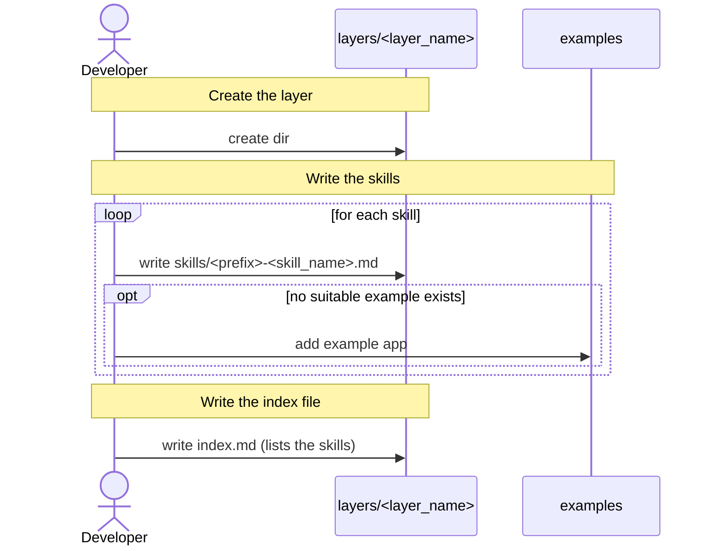

[comment]: <> (This file is auto-generated. Do not edit directly.)

# s10_a_developer_adds_a_new_layer

## A developer adds a new layer

A developer adds a layer with the instructions for generating the code for a particular technology (e.g.
`python_lib`). Targets combine these layers.

### Steps

#### It creates the layer

The developer creates the `layers/<layer_name>` dir in the prompts-dir, where `<layer_name>` is snake_case (e.g.
`django_app`). 

#### It writes the skills

The developer writes one markdown file per skill in the `skills` dir of the layer. A skill describes how to
implement a particular pattern within the layer (e.g. how to write the `settings.py` file of a python library). 
The name of a skill file starts with a prefix that identifies the layer (e.g. `py-write-settings.md`). 
A skill may refer to example code in the `examples` dir of the prompts-dir. If no suitable example exists, the
developer adds a new example app. 

#### It writes the index file

The developer writes the `index.md` file of the layer, which is the starting point for the agent. It lists the
skills, each with a short description and a link to the skill file. 

### Diagram

