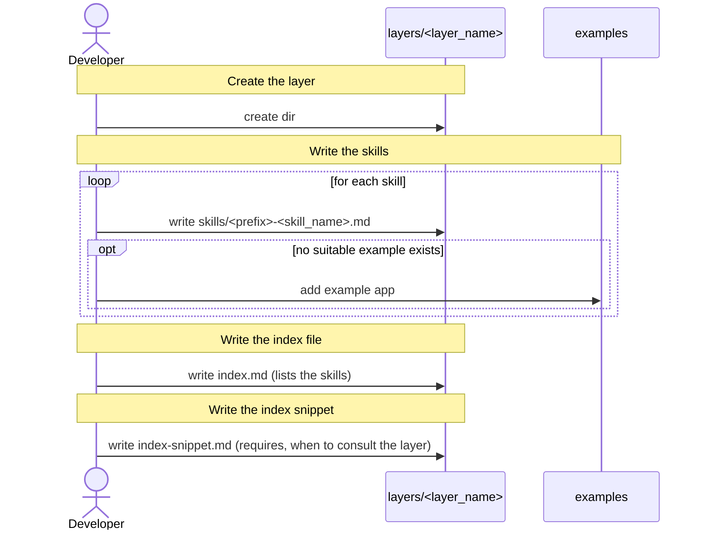

[comment]: <> (This file is auto-generated. Do not edit directly.)

# s10_a_developer_adds_a_new_layer

## A developer adds a new layer

A developer adds a layer with the instructions for generating the code for a particular technology (e.g.
`python_lib`). Users install any combination of layers in their project.

### Steps

#### It creates the layer

The developer creates the `layers/<layer_name>` dir in the prompts-dir, where `<layer_name>` is snake_case (e.g.
`django_app`). 

#### It writes the skills

The developer writes one markdown file per skill in the `skills` dir of the layer. A skill describes how to
implement a particular pattern within the layer (e.g. how to write the `settings.py` file of a python library). 
The name of a skill file starts with a prefix that identifies the layer (e.g. `py-write-settings.md`). 
A skill may refer to example code in the `examples` dir of the prompts-dir, with a path that is relative to the
project's `instructions` dir (e.g. `examples/blogs/...`). If no suitable example exists, the developer adds a new
example app. 
A skill refers to a skill of another layer by its name (e.g. "the `py-write-settings` skill of the python_lib
layer"), rather than by a relative path, because that layer may not be installed. 

#### It writes the index file

The developer writes the `index.md` file of the layer, which is the starting point for the agent. It lists the
skills, each with a short description and a link to the skill file, and the key principles of the layer. 

#### It writes the index snippet

The developer writes the `index-snippet.md` file of the layer. mn-prompts inserts it into the `index.md` that it
generates in the project, so it tells the agent when to consult the layer's `index.md`, and names the reference app
of the layer. 
The frontmatter of the snippet lists the layers that the layer requires (e.g. `requires: [app, python_lib]`).
These are installed together with the layer, and their snippets come first in the generated index. 
The snippet is short, uses no `#` or `##` headings, and reads correctly with any combination of other layers. Its
links are relative to the project's `instructions` dir (e.g. `./django_app_layer/index.md`), because that's where
the snippet ends up. 

### Diagram

