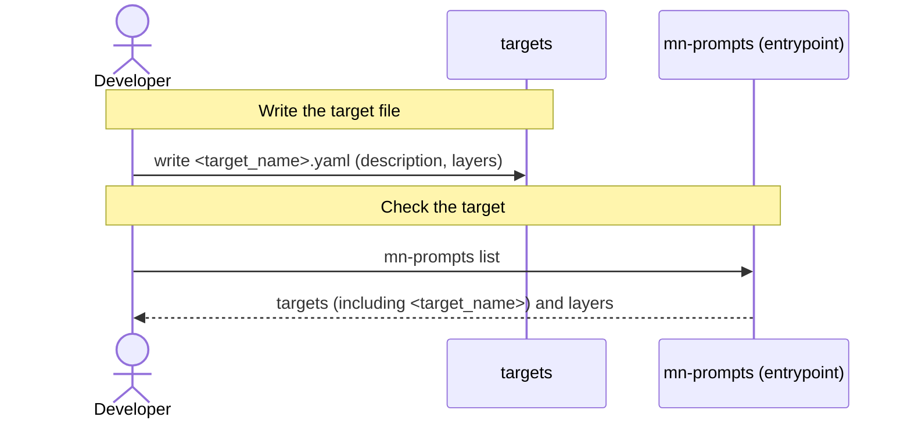

[comment]: <> (This file is auto-generated. Do not edit directly.)

# s20_a_developer_adds_a_new_target

## A developer adds a new target

A developer adds a target for a type of application (e.g. a django app). A target is a named set of layers, so
that a user can install these layers with a single option.

### Steps

#### It writes the target file

The developer writes the `targets/<target_name>.yaml` file in the prompts-dir. The `<target_name>` is the name that
the user passes to `mn-prompts install --target`. 
The file has a `description` of the type of application, and lists the `layers` of the technologies that this
application uses (e.g. `layers: [app, django_app, python_lib]`). The layers that these layers require don't need
to be listed, because they are installed automatically. 

#### It checks the target

The developer calls `mn-prompts list`, and checks that the new target is listed, with its description and
layers. 

### Diagram

