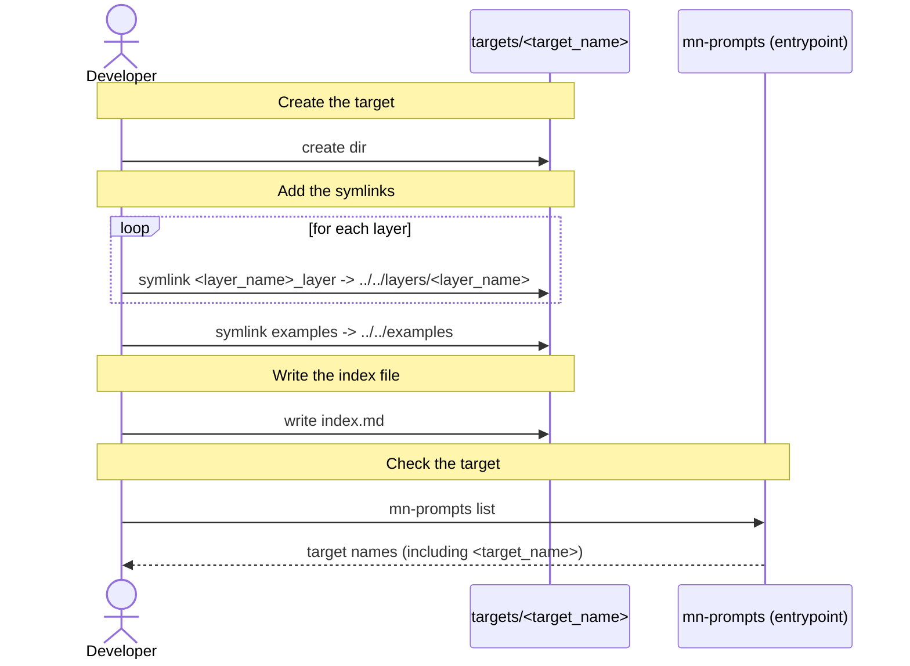

[comment]: <> (This file is auto-generated. Do not edit directly.)

# s20_a_developer_adds_a_new_target

## A developer adds a new target

A developer adds a target with the instructions for generating a type of application (e.g. a django app). The
target combines the layers of the technologies that this application uses.

### Steps

#### It creates the target

The developer creates the `targets/<target_name>` dir in the prompts-dir. The `<target_name>` is the name that the
user passes to `mn-prompts install`. 

#### It adds the symlinks

For each layer that the target uses, the developer adds a `<layer_name>_layer` symlink to
`../../layers/<layer_name>`. This lets targets share layers without duplicating them. 
The developer adds an `examples` symlink to `../../examples`. 

#### It writes the index file

The developer writes the `index.md` file of the target, which is the starting point for the agent. It explains
which layer `index.md` files to consult, and for what purpose, and refers to the relevant example apps. 

#### It checks the target

The developer calls `mn-prompts list`, and checks that the new target is listed. 

### Diagram

