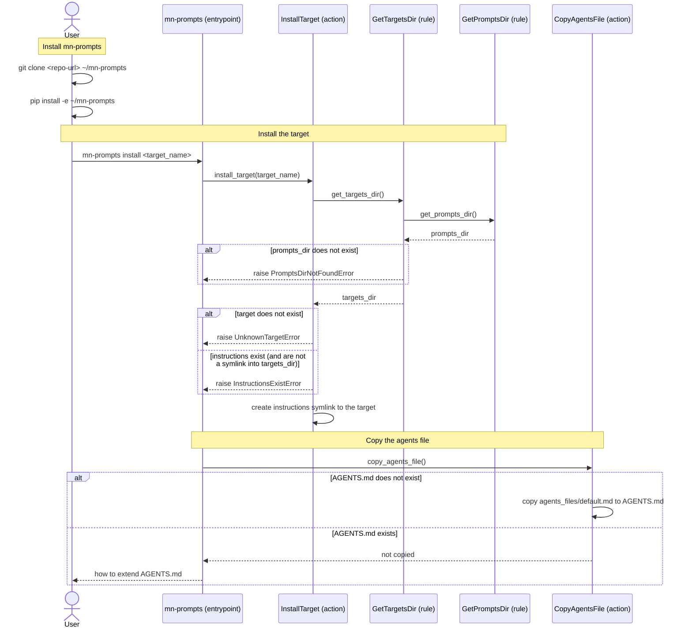

[comment]: <> (This file is auto-generated. Do not edit directly.)

# s30_a_user_installs_the_prompts_for_their_project

## A user installs the prompts for their project

A user installs the instructions of a target (e.g. `python_lib`) in their project. The project gets an
`instructions` symlink into the user's clone of mn-prompts, and an `AGENTS.md` file that tells the agent how to use
these instructions.

### Steps

#### It installs mn-prompts

The user clones the mn-prompts repository, and pip installs it as an editable install. 
Only editable installs are supported: the prompts-dir (`extra/prompts`) contains symlinks (e.g. from targets to
layers), which a wheel cannot contain. 
The user installs from a plain clone rather than with `pip install -e git+<url>`, because the latter puts the clone
inside the Python environment, where it's deleted when that environment is recreated. 

#### It installs the target

The user calls `mn-prompts install <target_name>` in the project dir. 
The entrypoint calls `install_target`, which locates the prompts-dir (via `get_targets_dir` and
`get_prompts_dir`) and checks that the target exists. 
`install_target` creates an `instructions` symlink to the target dir. An existing symlink into the prompts-dir is
replaced, so that the user can repair it, or switch to another target. 

#### It copies the agents file

The entrypoint calls `copy_agents_file`, which copies `agents_files/default.md` of the prompts-dir to `AGENTS.md`
in the project dir. 
If `AGENTS.md` already exists, then it's left unchanged, and the entrypoint prints how to extend it with the
contents of the agents file. 

### Diagram

