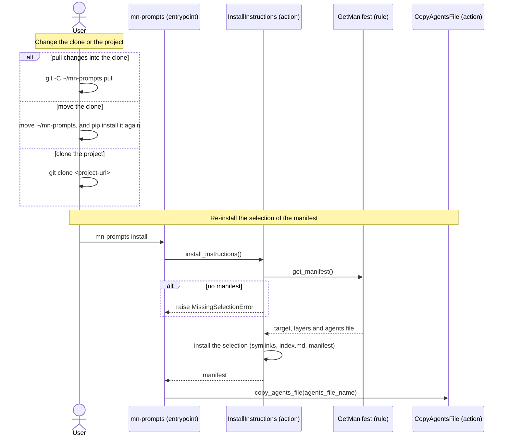

[comment]: <> (This file is auto-generated. Do not edit directly.)

# s35_a_user_reinstalls_the_instructions

## A user reinstalls the instructions

A user re-installs the instructions of their project with the selection that is recorded in its manifest. The
generated `index.md` contains copies of the index snippets, so this is how the project picks up changes in the
user's clone of mn-prompts.

### Steps

#### It changes the clone or the project

The user re-installs the instructions when:

- they pulled changes into their clone of mn-prompts, which may change the index snippets, the targets and the
  layers that layers require;
- they moved their clone, so that the symlinks in the `instructions` dir are dangling;
- they cloned a project in which a team member committed the manifest (and `project.md`) of the `instructions`
  dir. Whether to commit the instructions is up to the team.

#### It re-installs the selection of the manifest

The user calls `mn-prompts install` without a `--target` and `--layer`s. 
`install_instructions` calls `get_manifest`, which reads the target, the layers and the name of the agents file from
`instructions/mn-prompts.yaml`. Without a manifest, it raises a `MissingSelectionError` that explains the
options. 
`install_instructions` then installs this selection as usual: it resolves the layers again (so that a changed
target or layer is picked up), replaces the symlinks, and regenerates the index. 
The entrypoint calls `copy_agents_file` with the agents file of the manifest, unless the user passes
`--agents-md`, which switches the agents file to `AGENTS.md`. 

### Diagram

