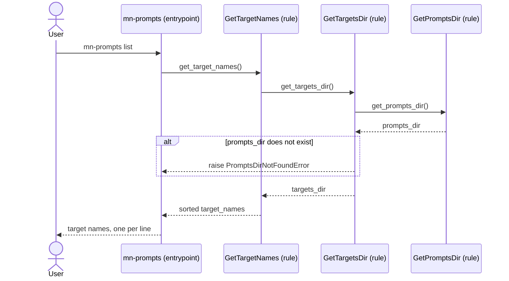

[comment]: <> (This file is auto-generated. Do not edit directly.)

# s40_a_user_lists_the_available_targets

## A user lists the available targets

A user lists the targets that they can install in their project.

### Steps

#### It lists the targets

The user calls `mn-prompts list`. 
The entrypoint calls `get_target_names`, which locates the prompts-dir (via `get_targets_dir` and
`get_prompts_dir`) and returns the names of the sub-dirs of its targets dir. 
The entrypoint prints the target names, one per line. 

### Diagram

