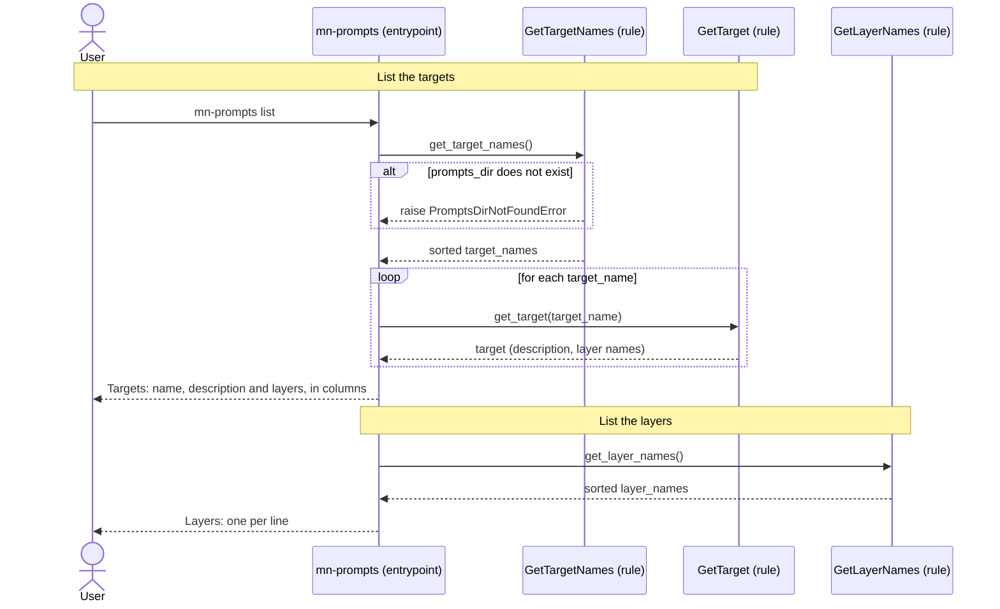

[comment]: <> (This file is auto-generated. Do not edit directly.)

# s40_a_user_lists_the_targets_and_layers

## A user lists the targets and layers

A user lists the targets and the layers that they can install in their project.

### Steps

#### It lists the targets

The user calls `mn-prompts list`. 
The entrypoint calls `get_target_names`, which locates the prompts-dir (via `get_prompts_dir`) and returns the names
of the target files in its targets dir, in alphabetical order. 
For each target, `get_target` reads the description and the layers from the target file. The entrypoint prints the
targets under a `Targets:` header, one per line, with the name, the description and the layers in columns. 

#### It lists the layers

The entrypoint calls `get_layer_names`, which returns the names of the dirs in the layers dir of the prompts-dir,
in alphabetical order. The entrypoint prints them under a `Layers:` header, one per line. 

### Diagram

