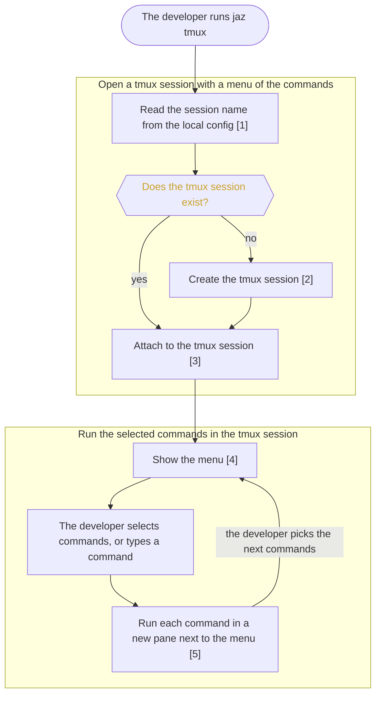

[comment]: <> (This file is auto-generated. Do not edit directly.)

# s10_a_developer_runs_commands_in_a_tmux_session

## A developer runs commands in a tmux session

The developer opens a tmux session for the blogs project, which has a menu of commands. Each command that the
developer picks runs in its own pane next to the menu.

## Diagram

### Footnotes

#### [1] - The tmux target delegates to the tmux_menu.py script

The root module loads `env/local/config/base.yaml` with `⚙️.load_config`. 
`jaz tmux` calls `open_session` of the `tmux_menu.py` script, which reads the config with `get_config`.
`open_session` reads the session name from `/tmux/session`. 

#### [2] - The session knows the config files of the project

`open_session` copies `JAZZOO_CONFIG_FILES` into the environment of the session, and starts `pick` in the `Menu`
window. 

#### [3] - Inside tmux, the developer switches to the session

When the developer is already inside tmux, `open_session` switches to the session instead of attaching to it. 

#### [4] - The menu is defined in the local config

`pick` reads the menu from `/tmux/menu`. 

#### [5] - The developer can pick several commands at once

The developer selects one or more commands (e.g. `1,3-4`). For each selected command, `pick` splits the `Menu`
window and sends the command to the new pane. 
`pick` then selects the menu pane again, so that the developer can pick the next commands. 

