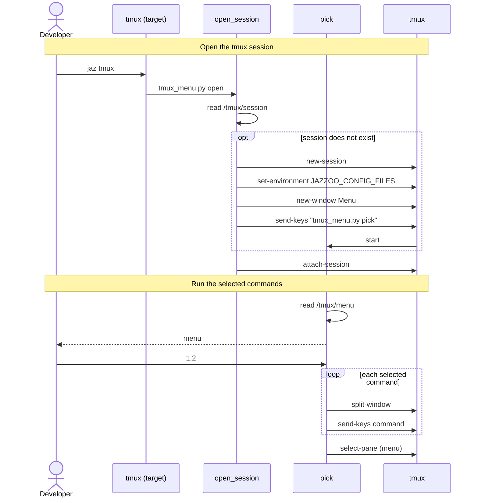

[comment]: <> (This file is auto-generated. Do not edit directly.)

# s10_a_developer_runs_commands_in_a_tmux_session

## A developer runs commands in a tmux session

The developer runs `jaz tmux` to open a tmux session for the blogs project. The session
has a menu of commands, which is defined under `/tmux/menu` in the local config. Each
command that the developer picks runs in its own pane next to the menu. The `tmux`
target delegates to the `tmux_menu.py` script, which reads the config with
`get_config`.

### Steps

#### It opens the tmux session

The root module loads `env/local/config/base.yaml` with `⚙️.load_config`. 
The developer runs `jaz tmux`, which calls `open_session`. 
`open_session` reads the session name from `/tmux/session`. 
If the session does not exist yet, `open_session` creates it, copies
`JAZZOO_CONFIG_FILES` into the session environment, and starts `pick` in the
`Menu` window. 
Finally, `open_session` attaches to the session (or switches to it when the developer
is already inside tmux). 

#### It runs the selected commands

`pick` reads the menu from `/tmux/menu` and shows it. 
The developer selects one or more commands (e.g. `1,3-4`), or types a command. 
For each selected command, `pick` splits the `Menu` window and sends the command to the
new pane. 
`pick` then selects the menu pane again, so that the developer can pick the next
commands. 

### Diagram

