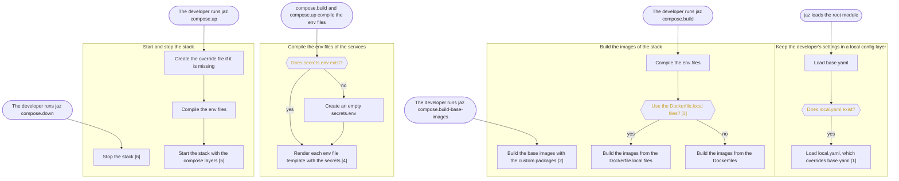

[comment]: <> (This file is auto-generated. Do not edit directly.)

# s20_a_developer_builds_and_starts_the_stack

## A developer builds and starts the stack

The developer builds and runs the blogs stack with the `compose` layer of the root module. The targets run
`docker compose` with the compose files of the local env.

## Diagram

### Footnotes

#### [1] - local.yaml holds the settings of the developer

`local.yaml` belongs to the developer and is not in git. Because it is loaded last, it overrides `base.yaml`, e.g.
`/compose/use_dockerfile_local`, `/compose/os_custom_packages` and `/docker/shell`. 

#### [2] - The compose targets delegate to compose_tools.py

Each target delegates to `compose_tools.py`, which runs with `⚙️.python`, the Python that runs `jaz`, so that it can
import `jazzoo`. 
`compose.build-base-images` passes the custom packages of `/compose` as build args, and builds the images of
`docker-compose.base-images.yml`. 

#### [3] - The local argument overrides the config

The images are built from the `Dockerfile.local` files when `local=true` is given, or when
`/compose/use_dockerfile_local` is true and `local` is not given. 

#### [4] - The env files are rendered from templates

`compile_env_files` renders each `env/local/docker/env_files/<service>.env.in` into `<service>.env`, filling in the
secrets of `secrets.env`. 

#### [5] - The stack is started with the compose layers

The compose layers are the base file, the src overlays, the `Dockerfile.local` images (when local is on) and the
override file. 

#### [6] - compose.down can also remove the volumes

`compose.down` stops the stack and removes its containers. With `volumes=true`, it also removes the volumes of the
stack, so that the next `compose.up` starts with a new and uninitialised stack. 

