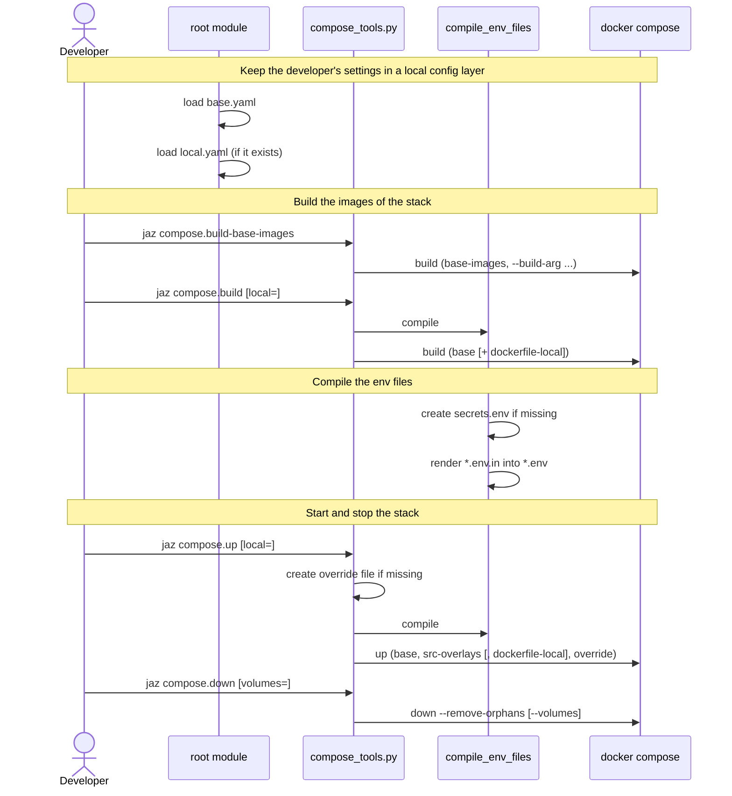

[comment]: <> (This file is auto-generated. Do not edit directly.)

# s20_a_developer_builds_and_starts_the_stack

## A developer builds and starts the stack

The developer builds and runs the blogs stack with the `compose` layer of the root
module (`jaz compose.build-base-images`, `compose.build`, `compose.up` and
`compose.down`). Each target delegates to `compose_tools.py`, which runs
`docker compose` with the compose files of the local env. The scripts run with
`⚙️.python`, the Python that runs `jaz`, so that they can import `jazzoo`.

### Steps

#### It keeps the developer's settings in a local config layer

The root module loads `env/local/config/base.yaml`, and then
`env/local/config/local.yaml` if it exists. 
`local.yaml` belongs to the developer and is not in git. Because it is loaded last,
it overrides `base.yaml`, e.g. `/compose/use_dockerfile_local`,
`/compose/os_custom_packages` and `/docker/shell`. 

#### It builds the images of the stack

The developer runs `jaz compose.build-base-images`. It passes the custom packages of
`/compose` as build args, and builds the images of
`docker-compose.base-images.yml`. 
The developer runs `jaz compose.build`. It first compiles the env files. The images
are built from the `Dockerfile.local` files when `local=true` is given, or when
`/compose/use_dockerfile_local` is true and `local` is not given. 

#### It compiles the env files of the services

`compile_env_files` creates an empty `secrets.env` if it is missing, and renders each
`env/local/docker/env_files/<service>.env.in` into `<service>.env`, filling in the
secrets of `secrets.env`. 

#### It starts and stops the stack

The developer runs `jaz compose.up`. It creates an empty
`docker-compose.override.yml` if it is missing, compiles the env files, and starts
the stack with the compose layers: the base file, the src overlays, the
`Dockerfile.local` images (when local is on) and the override file. 
The developer runs `jaz compose.down`, which stops the stack and removes its
containers. With `volumes=true`, it also removes the volumes of the stack, so that
the next `compose.up` starts with a new and uninitialised stack. 

### Diagram

