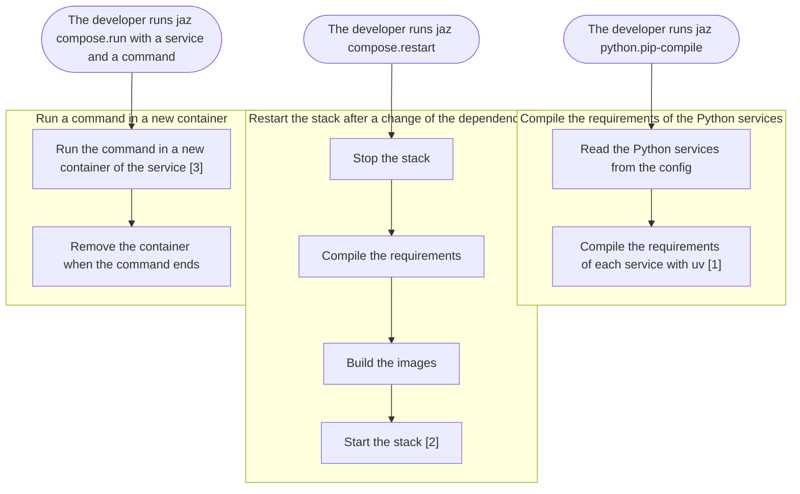

[comment]: <> (This file is auto-generated. Do not edit directly.)

# s30_a_developer_restarts_the_stack

## A developer restarts the stack

After a change of the dependencies, the developer compiles the requirements of the Python services and restarts
the stack. They also run one-off commands (e.g. the migrations) in a new container of a service.

## Diagram

### Footnotes

#### [1] - uv resolves the editable libraries in src/libs

`python.pip-compile` delegates to `python_tools.py`, which reads the services from `/python/services`. 
For each service, it runs `uv pip compile` in the directory of the service, which compiles `requirements.in` and
`requirements.editable` into `requirements.txt`. `BLOGS_LIBS_DIR` points to `src/libs`, so that the editable
libraries (`-e ${BLOGS_LIBS_DIR}/jazzoo`, ...) resolve. 

#### [2] - The restart stops when a step fails

`compose.restart` delegates to `compose_tools.py`. Its `local` and `no-cache` arguments are passed on to `build` and
`up`. 
When a step fails, the restart stops. 

#### [3] - The command runs with the compose files of up

The developer runs e.g. `jaz compose.run blogs_be cmd="python manage.py migrate"`. docker compose runs the command in
a new container of the service, with the same compose files as `up`. Without `cmd`, the container runs the command of
the service. 

