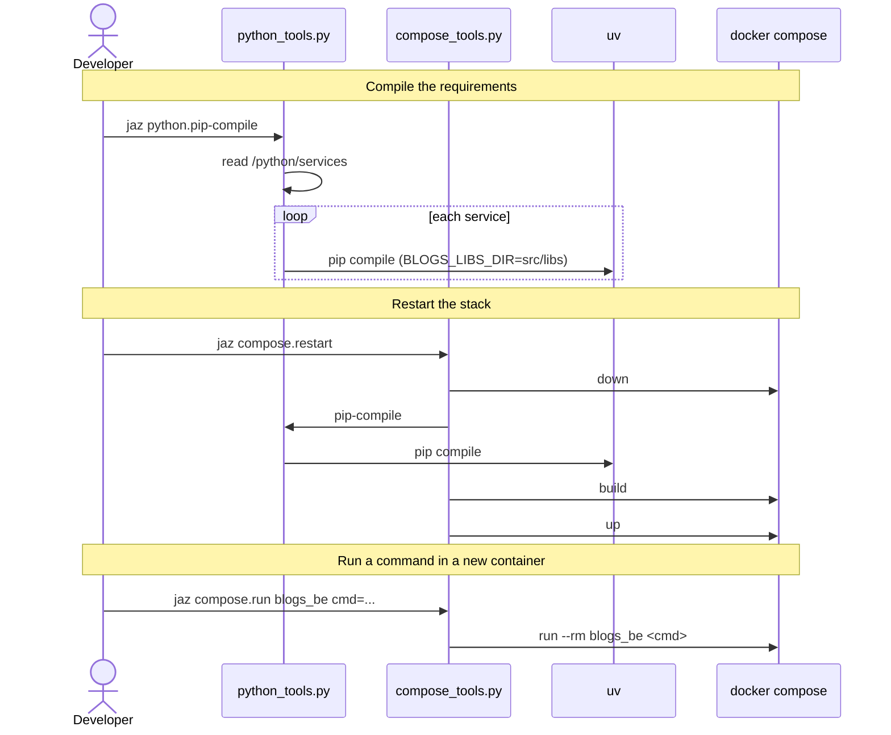

[comment]: <> (This file is auto-generated. Do not edit directly.)

# s30_a_developer_restarts_the_stack

## A developer restarts the stack

After a change of the dependencies, the developer compiles the requirements of the
Python services and restarts the stack. They also run one-off commands (e.g. the
migrations) in a new container of a service. `python.pip-compile` delegates to
`python_tools.py`, and the compose targets to `compose_tools.py`.

### Steps

#### It compiles the requirements of the Python services

The developer runs `jaz python.pip-compile`, which reads the services from
`/python/services`. 
For each service, it runs `uv pip compile` in the directory of the service, which
compiles `requirements.in` and `requirements.editable` into `requirements.txt`.
`BLOGS_LIBS_DIR` points to `src/libs`, so that the editable libraries
(`-e ${BLOGS_LIBS_DIR}/jazzoo`, ...) resolve. 

#### It restarts the stack

The developer runs `jaz compose.restart`, which stops the stack, compiles the
requirements, builds the images and starts the stack. Its `local` and `no-cache`
arguments are passed on to `build` and `up`. 
When a step fails, the restart stops. 

#### It runs a command in a new container

The developer runs e.g. `jaz compose.run blogs_be cmd="python manage.py migrate"`.
docker compose runs the command in a new container of the service, with the same
compose files as `up`, and removes the container when the command ends. Without
`cmd`, the container runs the command of the service. 

### Diagram

