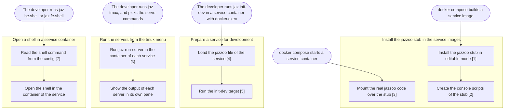

[comment]: <> (This file is auto-generated. Do not edit directly.)

# s40_a_developer_runs_the_servers

## A developer runs the servers

Each service has a `jazzoo` file with its own targets, which run inside the container of the service: blogs_be has
the Postgres and Django targets (`create-db`, `migrate`, `run-server`, `init-dev`, ...), and blogs_fe has the React
targets (`install`, `run-server`, `init-dev`). jazzoo comes into the containers as a stub library.

## Diagram

### Footnotes

#### [1] - The service images install the stub from src/libs

Each service image installs the stub library in `src/libs/jazzoo` in editable mode. blogs_be installs it through
`requirements.editable`; the blogs_fe images first install `python3` and `bash`, which the alpine Node image
lacks. 

#### [2] - The stub declares the console scripts of jazzoo

The stub declares the same console scripts as jazzoo (`jaz`, `zoo`, ...), so the install creates them. 

#### [3] - jaz runs the real code without a rebuild

The real jazzoo code (`/home/maarten/projects/jazzoo/src`) is mounted over the stub in
`docker-compose.override.yml`. 

#### [4] - jaz loads the jazzoo file of the working directory

The developer runs e.g. `jaz docker.exec be cmd="jaz init-dev"`. In the container, `jaz` loads the `jazzoo` file of
the working directory (`/app/src`, the source of the service). 

#### [5] - init-dev prepares the database

The `init-dev` target creates the database and runs the migrations. 

#### [6] - The host has a layer per service

On the host, the `be` and `fe` layers (`env/local/jaz/be/be.jaz`, `env/local/jaz/fe/fe.jaz`) have the targets of
blogs_be and blogs_fe. 
The developer runs `jaz compose.up`, which starts the containers without the servers, and then `jaz tmux`, and picks
the commands of the `serve` category of the menu: `jaz be.run-server` and `jaz fe.run-server`. 
Each runs `jaz run-server` in the container of the service (`/be/container`, `/fe/container`) with
`service_tools.py`, which uses jazzoo's `run_docker`. 

#### [7] - The shell follows the docker shell by default

The shell command is `/be/shell` or `/fe/shell`. By default these follow `/docker/shell`. 
`jaz be.exec` and `jaz fe.exec` run any other command in the container in the same way. 

