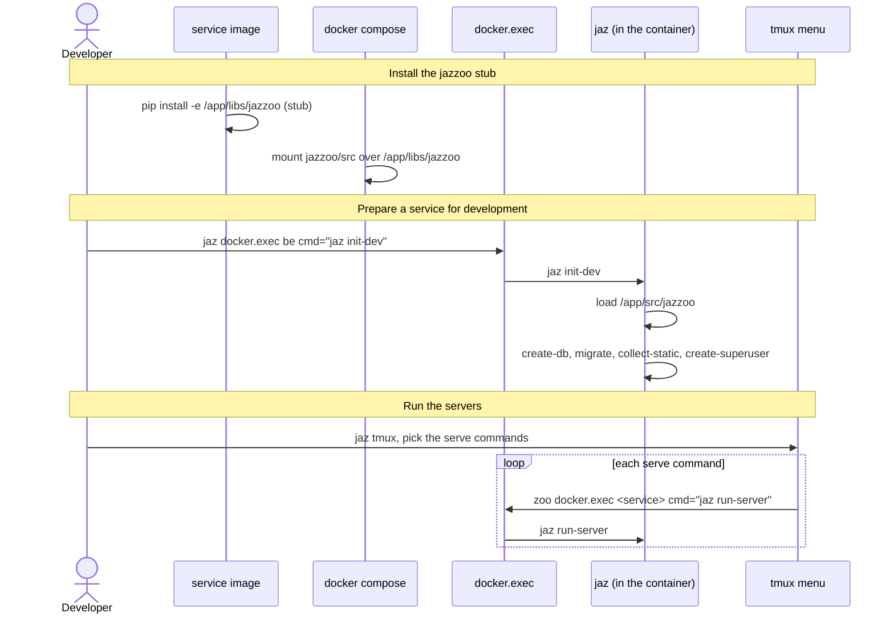

[comment]: <> (This file is auto-generated. Do not edit directly.)

# s40_a_developer_runs_the_servers

## A developer runs the servers

Each service has a `jazzoo` file with its own targets, which run inside the
container of the service: blogs_be has the Postgres and Django targets (`create-db`,
`migrate`, `run-server`, `init-dev`, ...), and blogs_fe has the React targets
(`install`, `run-server`, `init-dev`). jazzoo comes into the containers as a stub
library.

### Steps

#### It installs the jazzoo stub in the service images

Each service image installs the stub library in `src/libs/jazzoo` in editable mode.
blogs_be installs it through `requirements.editable`; the blogs_fe images first
install `python3` and `bash`, which the alpine Node image lacks. 
The stub declares the same console scripts as jazzoo (`jaz`, `zoo`, ...), so the
install creates them. 
When docker compose starts a container, it mounts the real jazzoo code
(`/home/maarten/projects/jazzoo/src`, in `docker-compose.override.yml`) over the
stub, so that `jaz` runs the real code without a rebuild. 

#### It prepares a service for development

The developer runs e.g. `jaz docker.exec be cmd="jaz init-dev"`. 
In the container, `jaz` loads the `jazzoo` file of the working directory
(`/app/src`, the source of the service), and runs its `init-dev` target, which
creates the database and runs the migrations. 

#### It runs the servers from the tmux menu

The developer runs `jaz tmux`, and picks the commands of the `serve` category of
the menu. 
Each command (`zoo docker.exec blogs_be cmd="jaz run-server"`, ...) runs the
`run-server` target in the container of the service, and shows the output of the
server in its own pane. 

### Diagram

