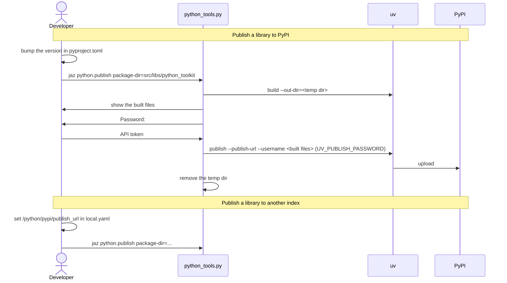

[comment]: <> (This file is auto-generated. Do not edit directly.)

# s50_a_developer_publishes_a_python_lib

## A developer publishes a Python library

The developer publishes one of their Python libraries to PyPI. The settings of the
upload (the user name and the url of the index) are in the `/python/pypi` section of
the config, so the developer only types their password, at the moment of the upload.
`python.publish` delegates to `python_tools.py`, which runs on the host.

### Steps

#### It publishes a library to PyPI

The developer bumps the `version` in the `pyproject.toml` of the library, because
PyPI never accepts the same version twice. 
They run e.g. `jaz python.publish package-dir=src/libs/python_toolkit`. A relative
`package-dir` is relative to the root dir of the project. 
`uv build` builds the sdist and the wheel into a temp dir, so that only the files of
this build are uploaded. The target shows the built files, so that the developer sees
the package name and version before the upload. 
The target asks for the password without echoing it. For PyPI, the user name is
`__token__`, and the password is an API token of the developer. The password is never
stored, and an empty password aborts the upload. 
`uv publish` uploads the built files to `/python/pypi/publish_url` as
`/python/pypi/username`. The password reaches `uv` in `UV_PUBLISH_PASSWORD`, so that
it never shows up in the args of a process. 
When the target ends, the temp dir is removed. 

#### It publishes a library to another index

To upload to another index (e.g. TestPyPI), the developer overrides
`/python/pypi/publish_url` in their own `local.yaml`, and runs `python.publish` as
before. 

### Diagram

