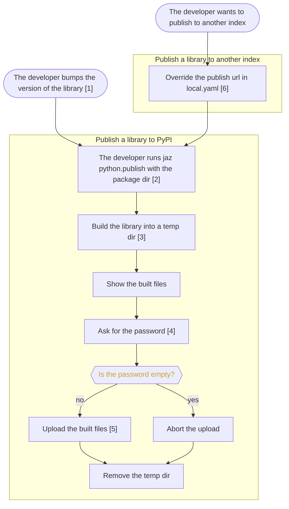

[comment]: <> (This file is auto-generated. Do not edit directly.)

# s50_a_developer_publishes_a_python_lib

## A developer publishes a Python library

The developer publishes one of their Python libraries to PyPI. The settings of the upload (the user name and the url
of the index) are in the `/python/pypi` section of the config, so the developer only types their password, at the
moment of the upload.

## Diagram

### Footnotes

#### [1] - PyPI never accepts the same version twice

The developer bumps the `version` in the `pyproject.toml` of the library. 

#### [2] - A relative package dir is relative to the root dir of the project

The developer runs e.g. `jaz python.publish package-dir=src/libs/python_toolkit`. 
`python.publish` delegates to `python_tools.py`, which runs on the host. 

#### [3] - Only the files of this build are uploaded

`uv build` builds the sdist and the wheel into a temp dir. The target shows the built files, so that the developer
sees the package name and version before the upload. 

#### [4] - The password is never stored

The target asks for the password without echoing it. For PyPI, the user name is `__token__`, and the password is an
API token of the developer. 

#### [5] - The password never shows up in the args of a process

`uv publish` uploads the built files to `/python/pypi/publish_url` as `/python/pypi/username`. The password reaches
`uv` in `UV_PUBLISH_PASSWORD`. 

#### [6] - The developer overrides the url of the index in their own config

To upload to another index (e.g. TestPyPI), the developer overrides `/python/pypi/publish_url` in their own
`local.yaml`, and runs `python.publish` as before. 

