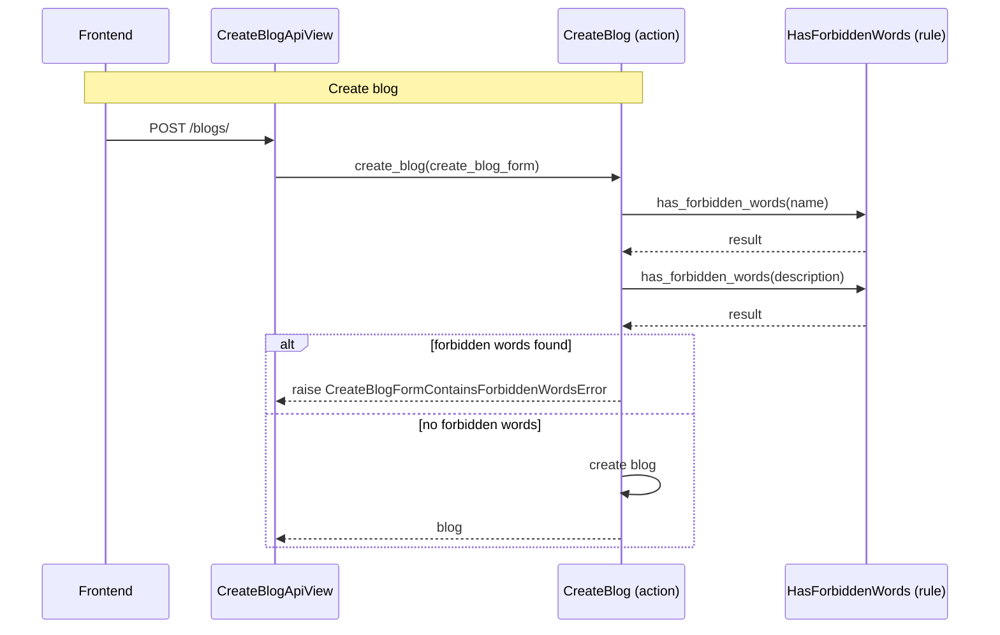

[comment]: <> (This file is auto-generated. Do not edit directly.)

# ms1_a_user_creates_a_blog

## A user creates a blog

The frontend calls `CreateBlogApiView` to create a new blog for a user.
The API view delegates to the `create_blog` action, which checks the `name` and `description`
fields for forbidden words before persisting the blog.

### Steps

#### It creates the blog

The frontend calls `CreateBlogApiView`. 
The API view calls `create_blog` with the `create_blog_form`. 
`create_blog` calls `has_forbidden_words` on the `name` and `description` fields. 
If forbidden words are found, `create_blog` raises `CreateBlogFormContainsForbiddenWordsError`. 
Otherwise, `create_blog` creates and returns the `blog`. 

### Diagram

