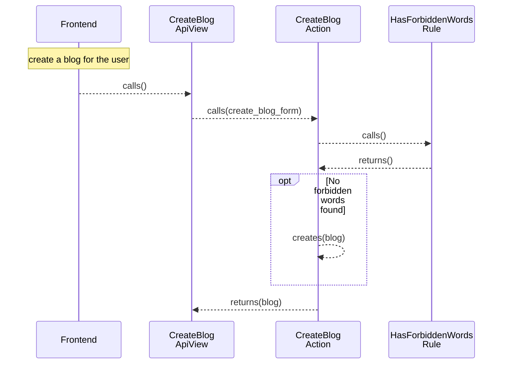

[comment]: <> (This file is auto-generated. Do not edit directly.)

# Scenario: ms1_a_user_creates_a_blog

## A user creates a blog

**Legend:**

- Frontend → External.Actors.Frontend
- CreateBlogApiView → Blogs.ApiViews.CreateBlogApiView
- CreateBlogAction → Blogs.Actions.CreateBlog
- HasForbiddenWordsRule → Blogs.Rules.HasForbiddenWords

