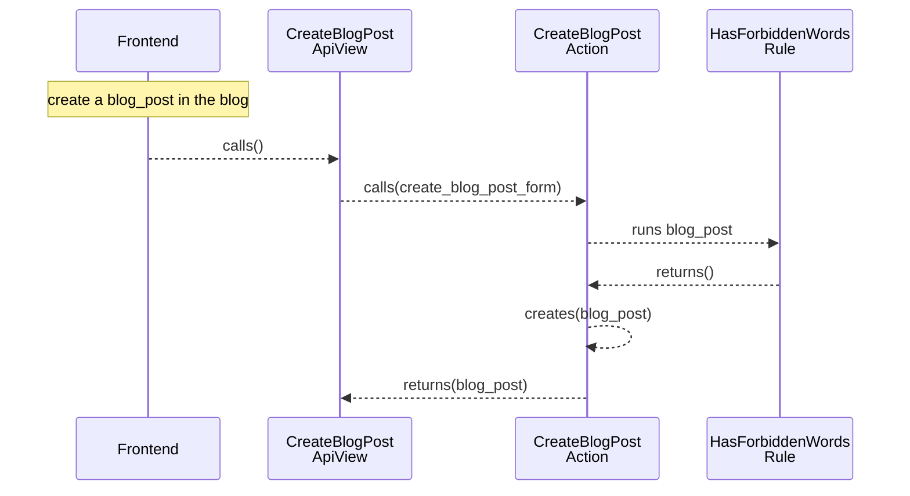

[comment]: <> (This file is auto-generated. Do not edit directly.)

# Scenario: ms2_a_user_creates_a_blog_post

## A user creates a blog post

**Legend:**

- Frontend → External.Actors.Frontend
- CreateBlogPostApiView → Blogs.ApiViews.CreateBlogPostApiView
- CreateBlogPostAction → Blogs.Actions.CreateBlogPost
- HasForbiddenWordsRule → Blogs.Rules.HasForbiddenWords

