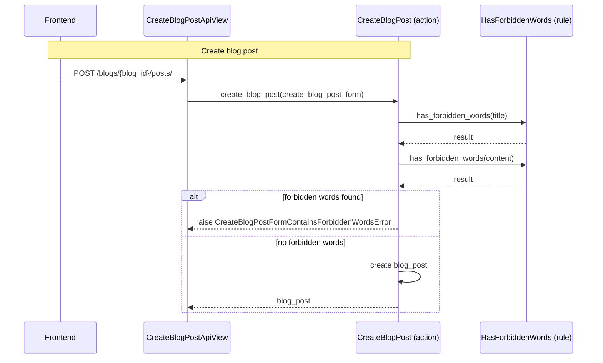

[comment]: <> (This file is auto-generated. Do not edit directly.)

# ms2_a_user_creates_a_blog_post

## A user creates a blog post

The frontend calls `CreateBlogPostApiView` to create a new blog post within a blog.
The API view delegates to the `create_blog_post` action, which checks the `title` and `content`
fields for forbidden words before persisting the post.

### Steps

#### It creates the blog post

The frontend calls `CreateBlogPostApiView`. 
The API view calls `create_blog_post` with the `create_blog_post_form`. 
`create_blog_post` calls `has_forbidden_words` on the `title` and `content` fields. 
If forbidden words are found, `create_blog_post` raises `CreateBlogPostFormContainsForbiddenWordsError`. 
Otherwise, `create_blog_post` creates and returns the `blog_post`. 

### Diagram

