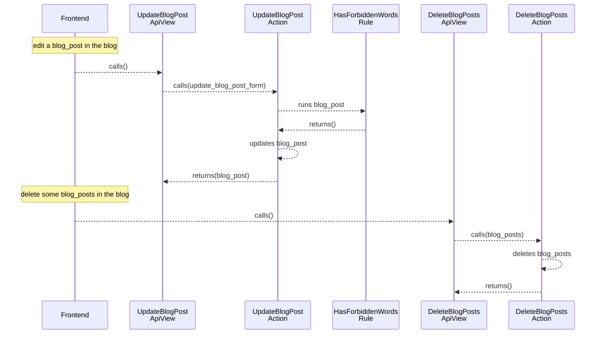

[comment]: <> (This file is auto-generated. Do not edit directly.)

# Scenario: ms3_a_user_edits_and_deletes_a_blog_post

## A user edits and deletes a blog post

**Legend:**

- Frontend → External.Actors.Frontend
- UpdateBlogPostApiView → Blogs.ApiViews.UpdateBlogPostApiView
- UpdateBlogPostAction → Blogs.Actions.UpdateBlogPost
- HasForbiddenWordsRule → Blogs.Rules.HasForbiddenWords
- DeleteBlogPostsApiView → Blogs.ApiViews.DeleteBlogPostsApiView
- DeleteBlogPostsAction → Blogs.Actions.DeleteBlogPosts

