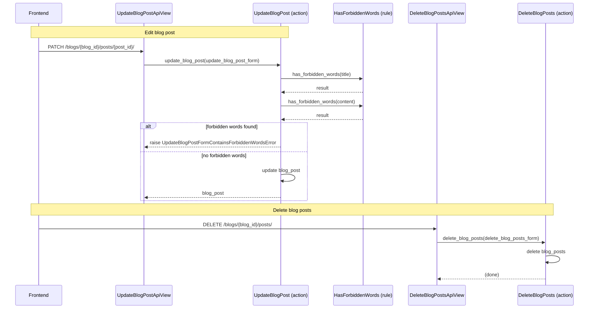

[comment]: <> (This file is auto-generated. Do not edit directly.)

# ms3_a_user_edits_and_deletes_a_blog_post

## A user edits and deletes a blog post

The frontend can update or delete blog posts. Updating checks the `title` and `content`
fields for forbidden words and raises an error if any are found. Deleting removes the
selected posts directly.

### Steps

#### It edits a blog post

The frontend calls `UpdateBlogPostApiView`. 
The API view calls `update_blog_post` with the `update_blog_post_form`. 
`update_blog_post` calls `has_forbidden_words` on the `title` and `content` fields. 
If forbidden words are found, `update_blog_post` raises `UpdateBlogPostFormContainsForbiddenWordsError`. 
Otherwise, `update_blog_post` updates and returns the `blog_post`. 

#### It deletes blog posts

The frontend calls `DeleteBlogPostsApiView`. 
The API view calls `delete_blog_posts` with the `delete_blog_posts_form`. 
`delete_blog_posts` deletes the posts. 

### Diagram

