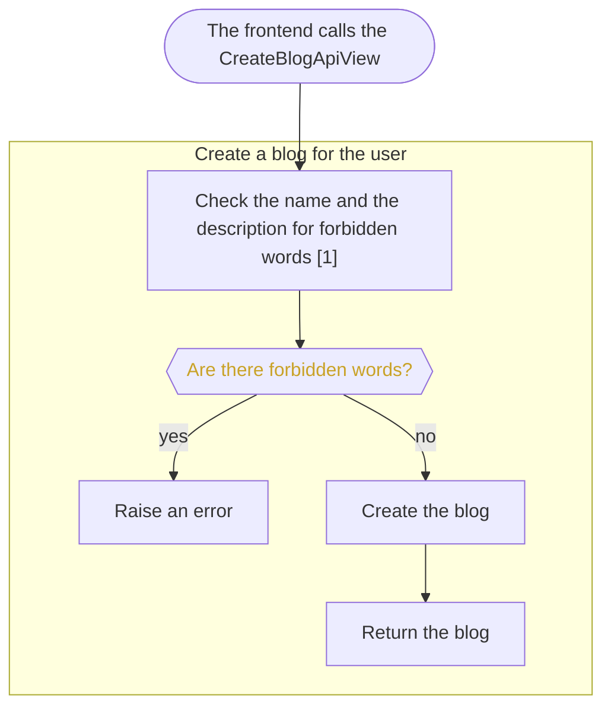

[comment]: <> (This file is auto-generated. Do not edit directly.)

# s10_a_user_creates_a_blog

## A user creates a blog

The frontend creates a new blog for the user through the API of the backend. A blog with forbidden words in its
name or description is refused.

## Diagram

### Footnotes

#### [1] - The action checks the form before it creates the blog

The API view calls `create_blog` with the `create_blog_form`. 
`create_blog` calls `has_forbidden_words` on the `name` and the `description`. When it finds forbidden words, it
raises `CreateBlogFormContainsForbiddenWordsError`. 

