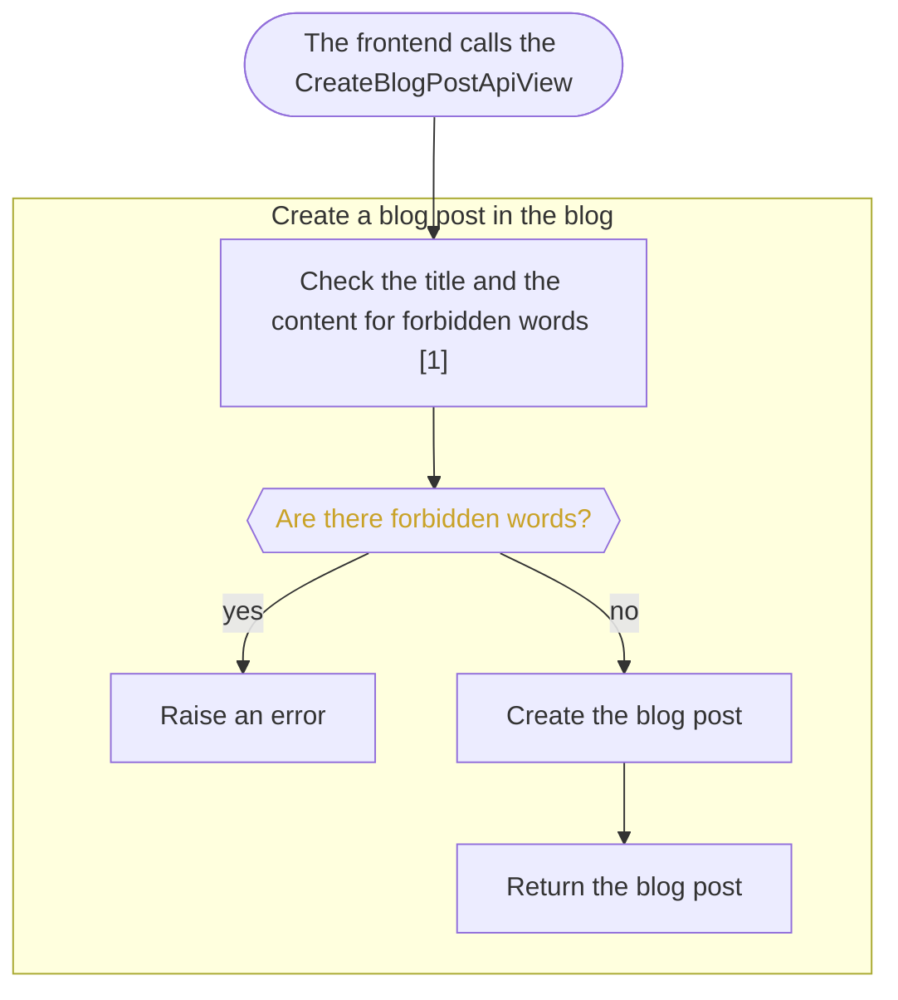

[comment]: <> (This file is auto-generated. Do not edit directly.)

# s20_a_user_creates_a_blog_post

## A user creates a blog post

The frontend creates a new blog post in a blog through the API of the backend. A blog post with forbidden words in
its title or content is refused.

## Diagram

### Footnotes

#### [1] - The action checks the form before it creates the blog post

The API view calls `create_blog_post` with the `create_blog_post_form`. 
`create_blog_post` calls `has_forbidden_words` on the `title` and the `content`. When it finds forbidden words, it
raises `CreateBlogPostFormContainsForbiddenWordsError`. 

