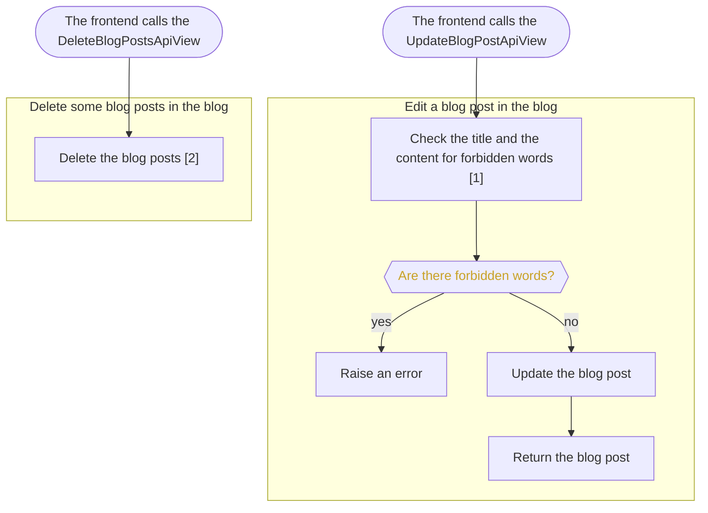

[comment]: <> (This file is auto-generated. Do not edit directly.)

# s30_a_user_edits_and_deletes_a_blog_post

## A user edits and deletes a blog post

The frontend updates or deletes blog posts through the API of the backend. An update with forbidden words in the
title or content is refused.

## Diagram

### Footnotes

#### [1] - The action checks the form before it updates the blog post

The API view calls `update_blog_post` with the `update_blog_post_form`. 
`update_blog_post` calls `has_forbidden_words` on the `title` and the `content`. When it finds forbidden words, it
raises `UpdateBlogPostFormContainsForbiddenWordsError`. 

#### [2] - The blog posts are deleted without a check

The API view calls `delete_blog_posts` with the `delete_blog_posts_form`, which deletes the selected posts. 

