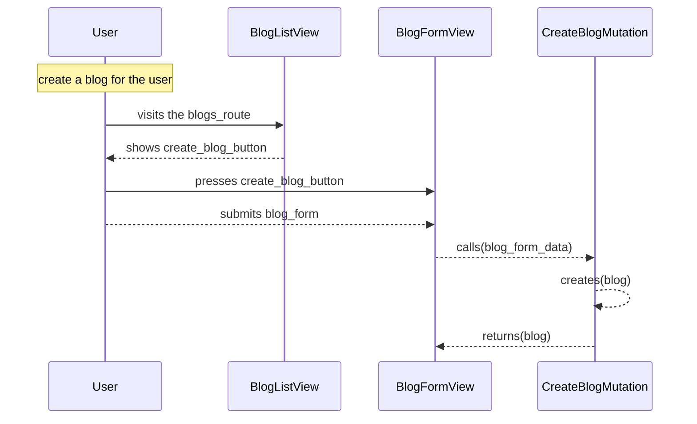

[comment]: <> (This file is auto-generated. Do not edit directly.)

# Scenario: s10_a_user_creates_a_blog

## A user creates a blog

**Legend:**

- User → External.Actors.User
- BlogListView → Blogs.Views.BlogListView
- BlogFormView → Blogs.Views.BlogFormView
- CreateBlogMutation → Blogs.Mutations.CreateBlogMutation

