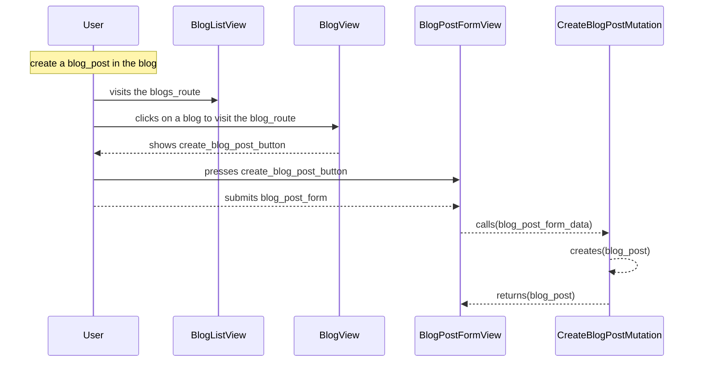

[comment]: <> (This file is auto-generated. Do not edit directly.)

# Scenario: s20_a_user_creates_a_blog_post

## A user creates a blog post

**Legend:**

- User → External.Actors.User
- BlogListView → Blogs.Views.BlogListView
- BlogView → Blogs.Views.BlogView
- BlogPostFormView → Blogs.Views.BlogPostFormView
- CreateBlogPostMutation → Blogs.Mutations.CreateBlogPostMutation

