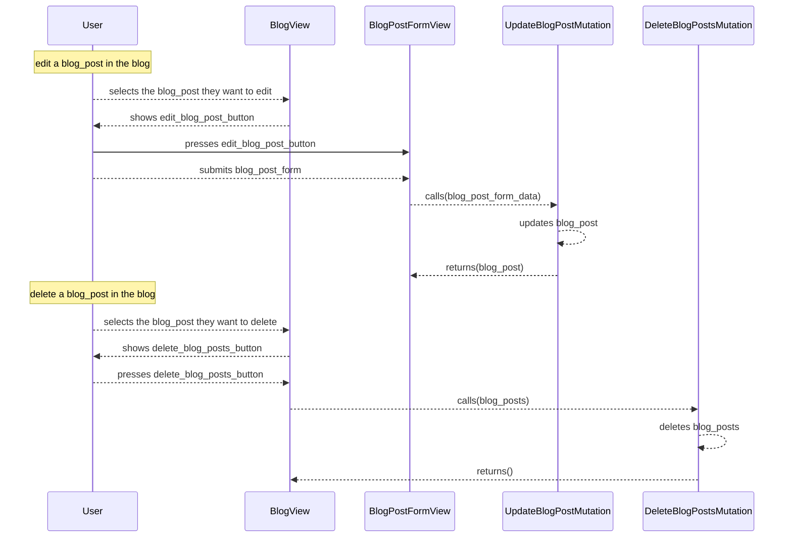

[comment]: <> (This file is auto-generated. Do not edit directly.)

# Scenario: s30_a_user_updates_a_blog_post

## A user updates and deletes a blog post

**Legend:**

- User → External.Actors.User
- BlogView → Blogs.Views.BlogView
- BlogPostFormView → Blogs.Views.BlogPostFormView
- UpdateBlogPostMutation → Blogs.Mutations.UpdateBlogPostMutation
- DeleteBlogPostsMutation → Blogs.Mutations.DeleteBlogPostsMutation

